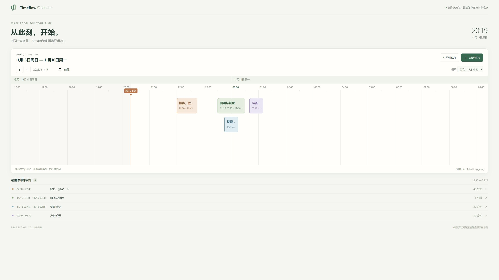

# Timeflow Calendar

[项目首页 / Project home](https://github.com/crazysong11/Timeflow-Calendar#readme)

A continuous timeline calendar for Windows. Start planning from this moment.



*Screenshot of the running browser preview with example events. The Windows app uses the same interface.*

## The idea

Timeflow Calendar presents your schedule on a continuous timeline: 23:00 today sits naturally next to 00:00 tomorrow. Even when part of the morning has passed, the time ahead is still yours to use.

- **Browse time continuously.** Drag or scroll through evenly spaced hourly markers, with date headers above the timeline.
- **Schedule at any time.** Create, edit, and delete events with minute-level start and end times. Events spanning midnight stay together, and overlapping events appear on separate rows.
- **Find your place.** Return to the current moment or jump to a date. The default automatic view fits the window; fixed 4-, 8-, 12-, and 24-hour views are also available.
- **Keep your schedule locally.** The Windows app saves events in SQLite and restores them when reopened. Events can include notes and a color.

## Current status

An early working version is available to run from source. Continuous browsing, event editing, and local persistence are implemented. The next step is to refine the interactions through everyday use and prepare the first Windows release.

## Basic use

1. Drag an empty part of the timeline to browse. The arrow buttons move half a screen; the left and right arrow keys move one hour when the timeline is focused.
2. Double-click empty space or select **新建事项** (New event), then enter a title and start/end times. For an event spanning midnight, choose the following date for its end.
3. Select a card or an item in the list below to edit it. Use **回到现在** (Back to now) to return to the current moment.

The interface is currently in Simplified Chinese. See the [usage guide](docs/usage.md) (Chinese) for scrolling, storage, and backup details.

## Run from source

Set up the prerequisites using the [Windows development guide](docs/development.md) (Chinese), then run these commands in PowerShell:

```powershell
git clone https://github.com/crazysong11/Timeflow-Calendar.git
cd Timeflow-Calendar
npm.cmd ci
npm.cmd run doctor
npm.cmd run desktop:dev
```

The development guide covers frontend previews, tests, and builds. Browser preview data is stored separately in that browser; the Windows app uses its own local database.

## Documentation and contributing

Project documentation is currently available in Chinese:

- [Usage guide](docs/usage.md)
- [Requirements and use cases](docs/requirements.md)
- [Technical design](docs/technical-design.md)
- [Windows development guide](docs/development.md)

Share use cases, interaction ideas, and bug reports through [Issues](https://github.com/crazysong11/Timeflow-Calendar/issues). Contributions to code, documentation, and translations are welcome through [Pull Requests](https://github.com/crazysong11/Timeflow-Calendar/pulls).

For bug reports, include reproduction steps and the expected and actual behavior. For feature suggestions, describe the situation in which you would use them.

## License

License selection is pending. The chosen license will be published in the repository's root `LICENSE` file before the first release.
