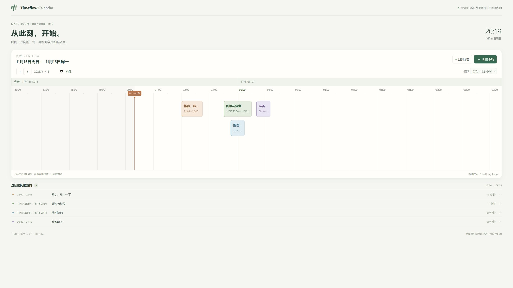

# Timeflow Calendar

点击语言标题展开内容。 / Select a language to read.

<details name="readme-language">
<summary><strong>English</strong></summary>

A continuous timeline calendar for Windows. Start planning from this moment.



*Screenshot of the running browser preview with example events. The Windows app uses the same interface.*

## The idea

Timeflow Calendar presents your schedule on a continuous timeline: 23:00 today sits naturally next to 00:00 tomorrow. Even when part of the morning has passed, the time ahead is still yours to use.

- **Browse time continuously.** Drag or scroll through evenly spaced hourly markers, with date headers above the timeline.
- **Schedule at any time.** Create, edit, and delete events with minute-level start and end times. Events spanning midnight stay together, and overlapping events appear on separate rows.
- **Find your place.** Return to the current moment or jump to a date. The default automatic view fits the window; fixed 4-, 8-, 12-, and 24-hour views are also available.
- **Keep it on your desktop.** Pin the calendar to the Windows desktop, move and resize it directly, and save its layout. A tray menu provides access to the regular window and exit action.
- **Keep your schedule locally.** The Windows app saves events in SQLite and restores them when reopened. Events can include notes and a color.

## Current status

An early working version is available to run from source. Continuous browsing, event editing, local persistence, and an adjustable desktop mode are implemented. The next step is to refine the interactions through everyday use and prepare the first Windows release.

## Basic use

1. Drag an empty part of the timeline to browse. The arrow buttons move half a screen; the left and right arrow keys move one hour when the timeline is focused.
2. Double-click empty space or select **新建事项** (New event), then enter a title and start/end times. For an event spanning midnight, choose the following date for its end.
3. Select a card or an item in the list below to edit it. Use **回到现在** (Back to now) to return to the current moment.
4. In the Windows app, select **贴到桌面** (Pin to desktop), then **调整布局** (Adjust layout). Drag the top handle to move it or the lower-right handle to resize it, and select **完成调整** (Finish adjusting) to lock the layout.

The interface is currently in Simplified Chinese. See the [usage guide](docs/usage.md) (Chinese) for scrolling, storage, and backup details.

## Run from source

Set up the prerequisites using the [Windows development guide](docs/development.md) (Chinese), then run these commands in PowerShell:

```powershell
git clone https://github.com/crazysong11/Timeflow-Calendar.git
cd Timeflow-Calendar
npm.cmd ci
npm.cmd run doctor
npm.cmd run desktop:dev
```

The development guide covers frontend previews, tests, and builds. Browser preview data is stored separately in that browser; the Windows app uses its own local database.

## Documentation and contributing

Project documentation is currently available in Chinese:

- [Usage guide](docs/usage.md)
- [Requirements and use cases](docs/requirements.md)
- [Technical design](docs/technical-design.md)
- [Desktop mode](docs/desktop-mode.md)
- [Windows development guide](docs/development.md)

Share use cases, interaction ideas, and bug reports through [Issues](https://github.com/crazysong11/Timeflow-Calendar/issues). Contributions to code, documentation, and translations are welcome through [Pull Requests](https://github.com/crazysong11/Timeflow-Calendar/pulls).

For bug reports, include reproduction steps and the expected and actual behavior. For feature suggestions, describe the situation in which you would use them.

## License

License selection is pending. The chosen license will be published in the repository's root `LICENSE` file before the first release.

</details>

<details name="readme-language" open>
<summary><strong>简体中文</strong></summary>

面向 Windows 的流式日历，让时间连续呈现，让安排从此刻开始。


*实际运行的浏览器预览截图，使用示例事项展示；Windows 应用采用相同界面。*

## 产品理念

Timeflow Calendar 用连续的时间轴呈现日程：今天的 23:00 与明天的 00:00 自然相邻。即使上午已经过去一半，接下来的时间依然可以充分利用。

- **连续浏览时间**：左右拖动或滚动，以均匀的小时刻度浏览过去与未来，上方日期头部帮助定位。
- **随时安排事项**：新增、编辑和删除事项，起止时间精确到分钟。跨午夜事项保持完整，重叠事项分行显示。
- **快速定位**：回到当前时刻或跳转日期。默认自动视野随窗口宽度展开，也可选择固定 4、8、12、24 小时。
- **贴到桌面**：把日历固定到 Windows 桌面，直接移动和调整大小，记住布局；通过托盘恢复普通窗口或退出。
- **本地保存**：Windows 应用使用 SQLite 保存日程，重新打开后恢复；事项支持备注与颜色。

## 当前状态

项目已有可从源码运行的早期版本，实现了连续浏览、事项编辑、本地保存和可调整布局的桌面模式。接下来结合日常使用完善交互体验，并准备首个 Windows 发布版本。

## 基本用法

1. 拖动时间轴空白处浏览时间。左右箭头按钮移动半屏；聚焦时间轴后，键盘左右方向键每次移动一小时。
2. 双击空白处或点击“新建事项”，填写标题和起止时间。跨午夜安排请选择次日的结束日期。
3. 点击事项卡片或下方列表进行编辑，通过“回到现在”返回当前时刻。
4. Windows 应用点击“贴到桌面”，再开启“调整布局”。拖动顶部移动位置，拖动右下角调整大小，点击“完成调整”固定布局。

滚轮操作、数据位置与备份方式见[使用指南](docs/usage.md)。

## 从源码运行

按 [Windows 开发指南](docs/development.md) 准备环境后，在 PowerShell 中运行：

```powershell
git clone https://github.com/crazysong11/Timeflow-Calendar.git
cd Timeflow-Calendar
npm.cmd ci
npm.cmd run doctor
npm.cmd run desktop:dev
```

前端预览、测试与应用构建详见开发指南。浏览器预览的数据单独保存在当前浏览器中，Windows 应用使用自己的本地数据库。

## 文档与贡献

- [使用指南](docs/usage.md)
- [基本需求与使用场景](docs/requirements.md)
- [技术方案](docs/technical-design.md)
- [桌面模式](docs/desktop-mode.md)
- [Windows 开发指南](docs/development.md)

欢迎通过 [Issues](https://github.com/crazysong11/Timeflow-Calendar/issues) 分享使用场景、讨论交互设计或反馈问题，也欢迎通过 [Pull Requests](https://github.com/crazysong11/Timeflow-Calendar/pulls) 改进代码、文档与翻译。

反馈问题时，请附上复现步骤、预期表现和实际表现；提出功能建议时，请说明具体的使用场景。

## 许可证

许可证待选定，确定后将在首次发布前公布于仓库根目录的 `LICENSE` 文件中。

</details>
